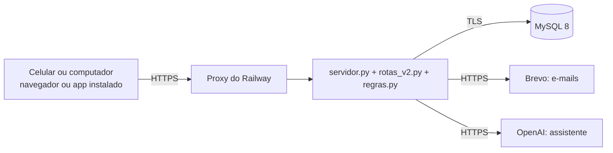

# Arquitetura do HemoFlow 2.1

**Autores:** José Kaike Gomes dos Santos e João Manoel da Silva Oliveira

## Visão geral

O sistema é uma página única (`static/index.html`). Depois do login, o navegador carrega o módulo do perfil da pessoa: o app do doador ou um dos painéis (hemocentro, parceiro e administração). As telas pedem os dados ao servidor pela API, sempre em JSON. O servidor confere a sessão e o perfil, aplica as regras e grava no MySQL.

## Camadas

| Camada | Arquivos | O que faz |
|---|---|---|
| Entrada | `static/index.html`, `static/js/app.js`, `static/js/fundo-login.js` | login com senha ou código, cadastro do doador, recuperação de senha e escolha da área pelo perfil |
| Peças comuns | `static/js/nucleo.js` | comunicação com a API, avisos, janelas, preferências de acessibilidade e consulta sem internet |
| App do doador | `static/js/doador.js` | início, agendar, vantagens e perfil |
| Painéis | `static/js/painel.js`, `banco.js`, `parceiro.js`, `admin.js` | hemocentro, parceiro e administração |
| Ajuda e assistente | `static/js/ajuda.js`, `static/js/assistente.js` | perguntas frequentes e chat com a IA |
| Visual | `static/css/app.css`, `login-3d.css` | tema claro e escuro, letra maior, alto contraste |
| Aplicativo | `static/manifest.webmanifest`, `static/sw.js` | instalação pelo QR Code |
| Servidor | `servidor.py` | sessão, segurança, login, recuperação de senha, suporte e arquivos das telas |
| Funcionalidades | `rotas_v2.py` | rotas do doador, do hemocentro, do parceiro, da administração, dos avisos e do assistente |
| Regras | `regras.py` | aptidão, compatibilidade, níveis do estoque, previsão, convocação, metas, cupons e níveis do doador |
| Assistente de IA | `assistente/` | agente com RAG ([como foi feito](assistente-rag.md)) |
| Banco | `banco/instalacao`, `banco/migracoes` | estrutura, dados de referência e alterações |

## Rotas da API

Cada rota declara o perfil exigido, e o servidor confere isso em todas as chamadas. Os dados de um hemocentro ou parceiro são sempre filtrados pela conta logada.

| Grupo | Exemplos | Perfil |
|---|---|---|
| Entrada | `/api/login`, `/api/login/codigo/enviar`, `/api/cadastro`, `/api/forgot-password` | livre |
| Doador | `/api/doador/inicio`, `/agendar`, `/historico`, `/vantagens`, `/cupons`, `/excluir-conta` | DOADOR |
| Hemocentro | `/api/banco/painel`, `/estoque/movimento`, `/convocacao/sugestao`, `/convocacoes`, `/confirmar` | BANCO |
| Parceiro | `/api/parceiro/painel`, `/ofertas`, `/cupons/validar`, `/ofertas/{id}/emergencia` | PARCEIRO |
| Administração | `/api/admin/bancos`, `/parceiros`, `/doadores`, `/contas`, `/entrar-como` | ADMINISTRADOR |
| Avisos | `/api/avisos`, `/api/avisos/lidos` | qualquer perfil |
| Assistente | `/api/doador/assistente`, `/api/parceiro/assistente`, `/api/assistente/status` | DOADOR ou PARCEIRO |
| Saúde | `/healthz` | livre |

A lista completa fica na tabela `ROTAS`, no começo do `rotas_v2.py`.

## Segurança

- As senhas são guardadas com PBKDF2-SHA256 (600.000 iterações) e sal aleatório. O código de login por e-mail também é guardado só como hash.
- A sessão fica em cookie `HttpOnly` e `SameSite=Strict` (e `Secure` na nuvem) e vale 8 horas.
- Depois de 5 senhas erradas, a conta fica bloqueada por 15 minutos. Também há limite de tentativas por IP.
- As consultas SQL são sempre parametrizadas.
- Todo texto mostrado na tela passa por `esc()`, e o servidor envia Content-Security-Policy e X-Frame-Options.
- O administrador pode "entrar como" outro perfil para dar suporte. Isso fica registrado na auditoria, e nesse modo ele não consegue excluir a conta de um doador.
- O cadastro tem consentimento específico para dados de saúde, e o doador pode excluir a própria conta pelo app (LGPD).

## Funcionamento sem internet

Cada tela guarda no aparelho a última resposta recebida, separada por conta. Sem conexão, a tela mostra esses dados com a faixa "Sem internet · dados de …". A confirmação de doação feita sem internet entra numa fila e é enviada quando a conexão volta. Tudo é apagado ao tocar em Sair.

## Execução

- **No computador:** `python scripts/dev.py` pede a senha do MySQL e reinicia o servidor a cada alteração, em http://127.0.0.1:8000.
- **Na nuvem:** o `Dockerfile` monta a imagem e o Railway publica a cada envio para a branch `main`. Detalhes em [implantacao.md](implantacao.md).
