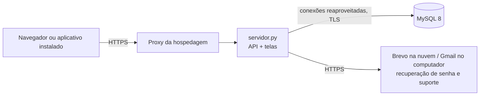

# Arquitetura do HemoFlow

## Visão geral

O sistema é uma **página única** (`static/index.html`). O `js/app.js` monta cada tela dentro dessa página e busca os dados no servidor pela API (`/api/...`), sempre em JSON. O `servidor.py` entrega as telas, valida tudo de novo, aplica as permissões e grava no MySQL.

## Camadas

| Camada | Arquivo | Responsabilidade |
|---|---|---|
| Telas | `static/index.html`, `static/css/estilos.css` | Estrutura e visual (vermelho/vinho e branco), responsivo para celular |
| Lógica das telas | `static/js/app.js` | Menu, telas, formulários, máscaras, avisos, notificações, modo sem conexão |
| Animação do login | `static/js/fundo-login.js` | Células de sangue e H em 3D |
| Aplicativo | `static/manifest.webmanifest`, `static/sw.js` | Instalação no celular/computador e abertura sem internet |
| Servidor | `servidor.py` | Rotas da API, sessão, permissões, regras de negócio, envio de e-mail |
| Banco | `banco/instalacao`, `banco/migracoes` | Estrutura, dados de referência e alterações |

## Rotas da API

| Método | Rota | Permissão | Função |
|---|---|---|---|
| POST | `/api/login`, `/api/logout` | — | Entrar e sair |
| GET | `/api/session` | — | Dados do usuário logado |
| POST | `/api/forgot-password`, `/api/reset-password` | — | Recuperação de senha |
| GET | `/api/summary` | painel.consultar | Indicadores do estoque |
| GET / POST | `/api/bags` | estoque.consultar / estoque.bolsa.criar | Listar e registrar bolsas |
| POST | `/api/bags/{id}/transition` | depende da situação | Reservar, liberar, transfundir, descartar |
| GET | `/api/movements` | estoque.consultar | Histórico |
| GET / POST | `/api/donors` | doadores.consultar / doadores.criar | Listar e cadastrar doadores |
| POST | `/api/donors/{id}/review` | doadores.editar | Marcar cadastro como revisado |
| DELETE | `/api/donors/{id}` | doadores.editar | Excluir doador |
| POST | `/api/professionals` | Administrador | Cadastrar profissional |
| GET / POST | `/api/access-accounts` | Administrador | Contas de acesso e perfis |
| GET | `/api/notifications` | usuário logado | Alertas do sino |
| POST | `/api/notifications/read`, `/api/notifications/preferences` | usuário logado | Dar baixa e ligar/desligar |
| POST | `/api/support` | usuário logado | Enviar mensagem ao suporte (e-mail) |
| GET | `/healthz` | — | Verificação de saúde (hospedagem) |

## Segurança

- Senhas guardadas com **PBKDF2-SHA256** (600.000 iterações) e sal aleatório.
- Sessão em cookie `HttpOnly` e `SameSite=Strict` (e `Secure` na nuvem), com validade de 8 horas.
- **Permissões verificadas no servidor** em todas as rotas; o frontend só esconde botões.
- Bloqueio de 15 minutos após 5 senhas erradas na mesma conta, e limite de tentativas por IP.
- Consultas SQL sempre parametrizadas (sem concatenar texto digitado pelo usuário).
- Textos exibidos na tela passam por `esc()` (proteção contra XSS); o servidor envia Content-Security-Policy e X-Frame-Options.
- Recuperação de senha: link de uso único, válido por 30 minutos; o banco guarda só o hash do token; a resposta é a mesma para e-mails cadastrados ou não.
- CPF do doador: dígitos verificadores conferidos no navegador e no servidor; a API só devolve o CPF mascarado (`***.456.789-**`).
- Suporte: no máximo 5 mensagens por hora por usuário.
- O modo sem conexão guarda no aparelho **somente dados do estoque** (sem dados pessoais), por até 24 horas, e apaga ao sair.

## Execução

- **No computador:** `iniciar_hemoflow.ps1` confere a senha do MySQL e inicia o `servidor.py` em http://127.0.0.1:8000.
- **Na nuvem:** o `Dockerfile` monta a imagem e o Railway publica a cada envio ao GitHub. Detalhes em [implantacao.md](implantacao.md).
