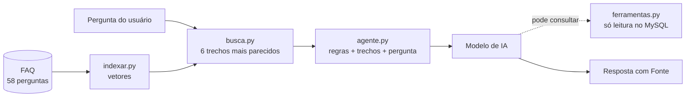

# Assistente HemoFlow: como fizemos o agente de IA com RAG

**Autores:** José Kaike Gomes dos Santos e João Manoel da Silva Oliveira
ADS, 4º período, Turma C (noite), UNINASSAU Caruaru, 2026

Este documento conta como o agente foi construído, por que tomamos cada decisão e como testamos. O código fica na pasta [`assistente/`](../assistente), e o guia para instalar e rodar está em [`assistente/README.md`](../assistente/README.md).

## 1. O que o agente faz

O Assistente HemoFlow responde dúvidas de doadores e de parceiros dentro do próprio aplicativo. Ele responde de duas formas:

- dúvidas gerais sobre doação de sangue e sobre o app: usa a base de conhecimento do projeto, o nosso FAQ;
- dúvidas sobre a própria pessoa ("quando posso doar de novo?", "como está a minha meta?"): consulta o banco de dados do HemoFlow, só para leitura e só os dados de quem está logado.

Ele não inventa. Se a resposta não está no FAQ nem no banco, ele diz que não encontrou e indica o banco de sangue, o HEMOPE ou a aba Ajuda. Também não dá orientação médica: dúvidas de saúde vão para a triagem. Toda resposta termina com a fonte usada.

No app do doador, o agente fica no botão 💬 no topo e em Perfil › Assistente HemoFlow. No painel do parceiro, fica no item Assistente, que responde só pelo FAQ.

## 2. Por que RAG

Um modelo de linguagem sozinho responde com o que aprendeu no treinamento, e isso não inclui as regras do HemoFlow nem os dados dos nossos usuários. Com RAG (recuperação aumentada por geração), antes de chamar a IA o sistema procura no nosso FAQ os trechos que mais se parecem com a pergunta e entrega só esses trechos junto com a pergunta. A IA passa a redigir a resposta em cima do nosso conteúdo, e a gente consegue mostrar de onde veio cada informação.

## 3. Como funciona, passo a passo

### 3.1 Base de conhecimento

O arquivo [`assistente/base/faq_hemoflow.txt`](../assistente/base/faq_hemoflow.txt) tem 14 seções e 58 perguntas com resposta, no mesmo formato do exemplo da disciplina. As seções vão de "Sobre o HemoFlow" até "Para parceiros", passando por quem pode doar, intervalos, compatibilidade, termômetro, agendamento, benefícios, cupons e LGPD. Há também uma versão em PDF ao lado.

### 3.2 Indexação (`indexar.py`)

O FAQ é dividido em trechos: cada trecho é uma pergunta com a sua resposta e o título da seção. Assim o agente consegue dizer de qual seção tirou a informação.

Para cada trecho geramos dois vetores (embeddings): um só da pergunta do FAQ e outro do trecho inteiro. Fizemos isso porque as pessoas perguntam de um jeito curto, parecido com a pergunta do FAQ, mas às vezes a palavra-chave só aparece na resposta. Com os dois vetores, a busca acerta nos dois casos.

No computador usamos o modelo `paraphrase-multilingual-MiniLM-L12-v2` (sentence-transformers), que roda local e entende português. Ele tem cerca de 470 MB e é baixado na primeira vez.

### 3.3 Busca (`busca.py`)

A pergunta vira um vetor e é comparada com todos os trechos pela semelhança de cosseno. A nota de cada trecho é a média das duas comparações (com a pergunta e com o trecho inteiro). Os 6 trechos com nota mais alta seguem para a IA.

Se nem o melhor trecho passar de um limite mínimo (o limiar), a pergunta está fora do assunto. Nesse caso o agente responde que não encontrou a informação, sem chamar a IA. Isso economiza crédito e evita resposta inventada.

### 3.4 Resposta (`agente.py`)

A IA (`gpt-4o-mini`, temperatura 0,2) recebe um prompt de sistema com 9 regras, os trechos encontrados e a pergunta. As regras, em resumo:

1. responder em português, curto e claro;
2. usar só os trechos e o resultado das ferramentas;
3. se não souber, dizer que não sabe e indicar onde procurar;
4. não dar diagnóstico nem orientação médica;
5. não inventar números, datas, endereços, horários ou estoque;
6. usar as ferramentas para dados da pessoa;
7. terminar com a linha "Fonte:";
8. em metas e benefícios, lembrar que a comprovação oficial é a declaração do hemocentro;
9. responder só o que foi perguntado.

Quem está logado como doador manda para a IA um único dado pessoal: o tipo sanguíneo. É o que permite responder "para quem posso doar?". Nome, CPF e contato nunca são enviados.

### 3.5 Ferramentas (`ferramentas.py`)

Seguimos o padrão de ferramentas visto em aula. A IA pode pedir para consultar o banco por meio de cinco funções:

| Ferramenta | O que devolve |
|---|---|
| `quando_posso_doar` | se a pessoa já pode doar e, se não, a partir de quando (usa as mesmas regras do app) |
| `minha_meta_isencao` | progresso na meta de doador regular (isenção em concursos de PE) |
| `meus_cupons_e_convocacoes` | cupons, convocações abertas e próximo agendamento |
| `nivel_do_estoque` | nível (normal, atenção ou crítico) de um tipo nos bancos parceiros |
| `locais_de_doacao` | endereços e horários dos locais cadastrados |

Cuidados que tomamos:

- o id do doador não é um parâmetro que a IA escolhe. Ele vem da sessão de quem está logado e fica preso às ferramentas, então a IA não consegue olhar os dados de outra pessoa, mesmo que alguém peça;
- toda consulta roda em transação somente leitura. No computador ainda usamos um usuário do MySQL que só tem permissão de SELECT (`hemoflow_leitura`); testamos uma escrita com ele e o MySQL recusou;
- as ferramentas não devolvem CPF, e-mail, telefone nem quantidade de bolsas.

### 3.6 Ligação com o aplicativo

O servidor do HemoFlow recebe a pergunta pelas rotas `/api/doador/assistente` e `/api/parceiro/assistente`. Antes de responder, ele confere dois limites para controlar o gasto com a IA:

- 15 perguntas a cada 10 minutos por pessoa;
- 100 perguntas por dia somando todo mundo. A conta é feita na tabela de auditoria, que registra só que houve uma pergunta, nunca o texto dela.

A conversa fica só na tela e não é salva.

## 4. Dois modos: computador e nuvem

| | No computador | Na nuvem (Railway) |
|---|---|---|
| Onde o agente roda | serviço separado, `servico.py`, porta 8765, aceita só o próprio computador e exige um segredo | dentro do próprio servidor do HemoFlow |
| Embeddings | modelo local `paraphrase-multilingual-MiniLM-L12-v2` | API da OpenAI, `text-embedding-3-small` |
| Limiar de "fora do assunto" | 0,25 | 0,40 |
| Banco | usuário só leitura `hemoflow_leitura` | conexão do HemoFlow, em transação só leitura |

No computador seguimos a pilha pedida na disciplina, com o modelo de embeddings rodando local. Na nuvem isso não cabia: o PyTorch e o modelo deixariam a imagem com uns 2 GB e gastariam mais memória do que o plano de teste do Railway oferece. Por isso, na nuvem, os vetores vêm da API da OpenAI, que custa frações de centavo. O índice do FAQ é montado na primeira pergunta (116 textos numa única chamada) e fica na memória.

Cada modelo dá notas numa escala diferente, por isso o limiar também muda. Medimos com perguntas reais no modo nuvem: as perguntas sobre o HemoFlow tiveram nota de 0,47 para cima, e as de fora do assunto (capital da França, receita de bolo, investimentos, celular) ficaram em 0,39 ou menos. Escolhemos 0,40.

A chave da OpenAI fica no arquivo `assistente/.env` no computador e na variável `OPENAI_API_KEY` do Railway. Ela nunca vai para o GitHub.

## 5. Testes

Montamos 15 perguntas em [`assistente/testes/perguntas.json`](../assistente/testes/perguntas.json): perguntas do FAQ, perguntas que dependem do banco (dados do doador e estoque), dúvidas de saúde e uma fora do escopo (previsão do tempo). O script [`rodar_testes.py`](../assistente/testes/rodar_testes.py) faz as perguntas e grava os trechos encontrados, a resposta e a fonte.

| Relatório | O que mostra |
|---|---|
| [`relatorio.md`](../assistente/testes/relatorio.md) | versão final no computador: as 15 respostas corretas, com a fonte certa |
| [`relatorio_nuvem.md`](../assistente/testes/relatorio_nuvem.md) | modo nuvem testado pelo próprio app: 15 respostas corretas, o parceiro respondido e a pergunta acima do limite diário recusada |
| [`relatorio_busca.md`](../assistente/testes/relatorio_busca.md) | primeira rodada, só da busca, guardada para comparar |

**O que aprendemos com os testes.** Na primeira versão, 5 das 15 respostas tinham problema: a busca trazia o trecho errado ou o limiar descartava perguntas boas. Melhoramos em quatro frentes:

- passamos a usar os dois vetores por trecho;
- subimos de 4 para 6 trechos enviados à IA;
- baixamos o limiar;
- reescrevemos algumas perguntas do FAQ e criamos a seção para parceiros.

Também passamos o tipo sanguíneo do doador como contexto e ajustamos a saída das ferramentas. Na versão final, as 15 respostas ficaram corretas.

## 6. Privacidade e custo

- As perguntas são processadas pela OpenAI. Os Termos de Uso e a Política de Privacidade (versão 1.2) avisam isso, e a tela do chat pede para não escrever CPF, senha ou dados de saúde.
- O único dado pessoal enviado é o tipo sanguíneo de quem está logado.
- Com os limites de 15 a cada 10 minutos por pessoa e 100 por dia, o gasto máximo fica bem abaixo de 1 dólar por dia.

## 7. Arquivos

| Arquivo | Função |
|---|---|
| `assistente/base/faq_hemoflow.txt` | base de conhecimento |
| `assistente/indexar.py` | divide o FAQ em trechos e gera os vetores |
| `assistente/busca.py` | busca por semelhança (modo local ou nuvem) |
| `assistente/agente.py` | regras, montagem do contexto e conversa com a IA |
| `assistente/ferramentas.py` | consultas só de leitura ao banco |
| `assistente/servico.py` | serviço local usado pelo app no computador |
| `assistente/config.py` | configurações lidas do `.env` ou das variáveis da nuvem |
| `assistente/chat_terminal.py` | conversa pelo terminal, para testar |
| `assistente/testes/` | perguntas, script e relatórios |
| `rotas_v2.py` (seção G2) | rotas do app, limites e modo nuvem |
| `static/js/assistente.js` | tela do chat |
