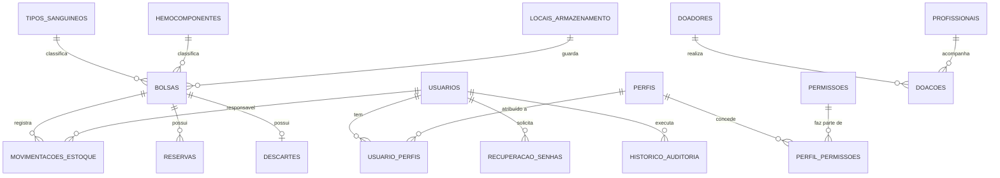

# Banco de dados do HemoFlow

MySQL 8, conjunto de caracteres `utf8mb4`. A estrutura completa está em [`banco/instalacao/`](../banco/instalacao) e as alterações feitas depois, em [`banco/migracoes/`](../banco/migracoes) (cada uma com o script para desfazer).

## Principais tabelas e relacionamentos

## Tabelas

### Acesso e segurança

| Tabela | Para que serve | Campos principais |
|---|---|---|
| `usuarios` | Contas de acesso | `nome`, `email` (único), `senha_hash`, `status`, `tentativas_falhas`, `bloqueado_ate`, `ultimo_login` |
| `perfis` | Administrador, Responsável técnico, Operador de estoque, Consulta | `nome` (único), `descricao` |
| `permissoes` | Ações do sistema (ex.: `doadores.criar`) | `codigo` (único), `modulo` |
| `perfil_permissoes` | Quais permissões cada perfil tem | `perfil_id`, `permissao_id` |
| `usuario_perfis` | Perfil de cada usuário | `usuario_id`, `perfil_id`, `atribuido_por` |
| `recuperacao_senhas` | Links de "Esqueceu sua senha?" | `usuario_id`, `token_hash` (único), `expira_em`, `usado_em` |
| `historico_auditoria` | Registro de quem fez o quê | `usuario_id`, `acao`, `modulo`, `entidade`, `detalhes_json` |
| `configuracoes` | Preferências (ex.: notificações de cada usuário) | `chave` (única), `valor_json` |

### Pessoas

| Tabela | Para que serve | Campos principais |
|---|---|---|
| `doadores` | Cadastro de doadores | `nome`, `cpf` (único, só números), `email` (único), `telefone`, `data_nascimento`, `tipo_sanguineo`, `peso_kg`, endereço (`cep`, `logradouro`, `numero`, `complemento`, `bairro`, `cidade`, `uf`), `codigo_ficticio`, `status`, `atualizado_em` |
| `profissionais` | Equipe licenciada | `nome`, `email` (único), `registro_profissional` (único), `cargo`, `telefone`, `usuario_id` |

O CPF é guardado só com os números e validado pelos dígitos verificadores. A tela de doadores mostra apenas o meio do número (`***.456.789-**`), por causa da LGPD. Doadores cadastrados antes da migração 004 ficam sem CPF.

### Estoque

| Tabela | Para que serve | Campos principais |
|---|---|---|
| `bolsas` | Bolsas de sangue | `codigo` (único), `tipo_sanguineo_id`, `hemocomponente_id`, `local_id`, `volume_ml`, `data_coleta`, `data_validade`, `status` |
| `movimentacoes_estoque` | Histórico de cada mudança de situação | `bolsa_id`, `tipo_movimentacao`, `status_anterior`, `status_novo`, `responsavel_id`, `motivo` |
| `reservas` | Reservas ativas e encerradas | `bolsa_id`, `status`, `reservada_por`, `liberada_em` |
| `descartes` | Motivo do descarte (uma por bolsa) | `bolsa_id` (único), `motivo_codigo`, `justificativa` |
| `tipos_sanguineos` | A+, A−, B+, B−, AB+, AB−, O+, O− | `codigo` |
| `hemocomponentes` | Sangue total, concentrado de hemácias, plasma... | `codigo`, `nome` |
| `locais_armazenamento` | Refrigeradores e prateleiras | `nome` (único) |

### Preparadas para evoluções futuras

`agendamentos`, `doacoes`, `alertas`, `regras_alerta`, `limites_estoque`, `notificacoes`, `mensagens`, `mensagem_destinatarios`, `execucoes_relatorios` e `sessoes` já existem na estrutura, mas ainda não são usadas pelas telas.

## Situações da bolsa

| Situação atual | Pode ir para |
|---|---|
| Disponível | Reservada, Transfundida, Descartada, Quarentena |
| Reservada | Disponível, Transfundida, Descartada |
| Quarentena | Disponível, Descartada |
| Transfundida / Descartada | — (final) |

Bolsa vencida não pode ser registrada como transfundida nem cadastrada como nova entrada.

## Regras garantidas pelo próprio banco

- E-mail único em `usuarios`, `doadores` e `profissionais` e CPF único em `doadores` (índices `UNIQUE`).
- Chaves estrangeiras impedem apagar um doador que já tem doações ou agendamentos.
- Uma reserva ativa por bolsa e um descarte por bolsa.
- Valores permitidos de situação, prioridade e status conferidos por `CHECK`.

## Migrações aplicadas

| Nº | O que faz | Script |
|---|---|---|
| 000 | Tipo sanguíneo e peso no doador | `scripts/migracao_000_tipo_sanguineo_peso.py` |
| 001 | E-mail único em doadores e profissionais | `scripts/migracao_001_email_unico.py` |
| 002 | Endereço do doador | `scripts/migracao_002_endereco_doador.py` |
| 003 | Tabela de recuperação de senha | `scripts/migracao_003_recuperacao_senha.py` |
| 004 | CPF do doador (único) | `scripts/migracao_004_cpf_doador.py` |
