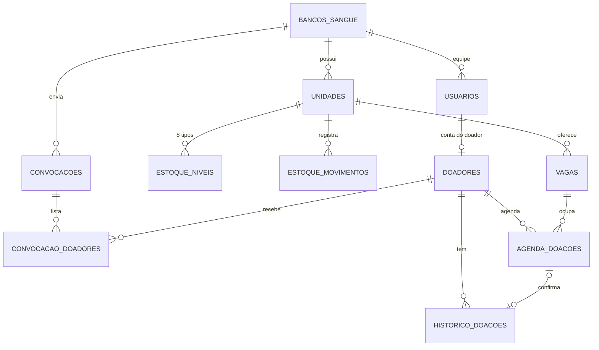
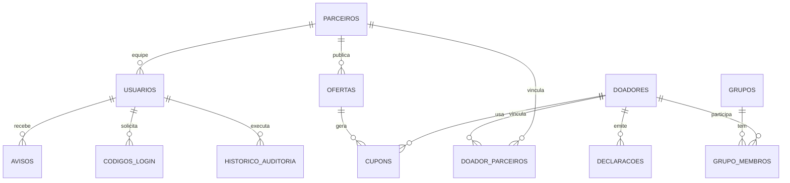

# Banco de dados do HemoFlow 2.1

**Autores:** José Kaike Gomes dos Santos e João Manoel da Silva Oliveira

O banco é MySQL 8, com `utf8mb4`. A estrutura completa para instalar do zero está em [`banco/instalacao/`](../banco/instalacao). As alterações feitas depois estão em [`banco/migracoes/`](../banco/migracoes), cada uma com o script para desfazer.

A versão 2.0 acrescentou as tabelas de captação, parceiros e engajamento, e a versão 2.1 acrescentou as declarações e a oferta de emergência. As tabelas de acesso, de auditoria e de doadores vieram da versão 1 e ganharam colunas novas. Nenhuma migração apagou dados.

## Captação

## Parceiros, engajamento e acesso

## Tabelas

| Grupo | Tabela | Para que serve |
|---|---|---|
| Acesso | `usuarios` | contas, hash da senha, bloqueio e vínculo com hemocentro (`banco_id`) ou parceiro (`parceiro_id`) |
| Acesso | `perfis`, `usuario_perfis` | perfis DOADOR, BANCO, PARCEIRO e ADMINISTRADOR |
| Acesso | `codigos_login`, `recuperacao_senhas` | código de 6 dígitos e link de recuperação, guardados como hash |
| Doador | `doadores` | dados do doador, sexo, consentimentos e responsável (16 e 17 anos) |
| Hemocentro | `bancos_sangue`, `unidades` | hemocentros privados, suas unidades e os locais públicos (tipo `PUBLICO`, só informativo) |
| Estoque | `estoque_niveis` | quantidade e limites de crítico e de atenção por tipo e unidade |
| Estoque | `estoque_movimentos` | entradas, saídas e ajustes (base da previsão) |
| Captação | `vagas`, `convocacoes`, `convocacao_doadores` | horários, convocações e quem foi convocado |
| Doação | `agenda_doacoes` | agendamentos com o código de 6 dígitos e a situação |
| Doação | `historico_doacoes` | doações verificadas pelo hemocentro ou declaradas pelo doador |
| Parceiros | `parceiros`, `ofertas`, `cupons` | parceiros, ofertas (inclusive de emergência) e cupons de uso único |
| Parceiros | `doador_parceiros`, `declaracoes` | vínculo de alunos com cursinhos e faculdades e declarações de doação |
| Engajamento | `grupos`, `grupo_membros`, `beneficios_estado` | grupos com meta e benefícios por estado |
| Controle | `avisos`, `historico_auditoria` | avisos do sino e registro de quem fez cada ação |

As tabelas da versão 1 que controlavam bolsa por bolsa (bolsas, movimentações, profissionais) continuam no banco, sem uso.

## Situações do agendamento

| Situação | Quando acontece |
|---|---|
| `AGENDADO` | o doador escolheu o horário |
| `CANCELADO` | o doador cancelou; o hemocentro é avisado e a vaga é oferecida a até 3 convocados |
| `COMPARECEU` | o hemocentro digitou o código depois da triagem e da coleta; a doação entra como verificada |
| `FALTOU` | o hemocentro marcou a falta |

## Regras garantidas pelo próprio banco

- Um nível de estoque por tipo e unidade, e o limite de atenção nunca menor que o crítico.
- Um horário por unidade e capacidade maior que zero.
- Código único para cupom, grupo e declaração, e um doador por conta.
- Valores aceitos para situação, origem, movimento e tipo de parceiro, conferidos por `CHECK`.
- Agendamento, confirmação, movimento de estoque e validação de cupom usam transação com `SELECT … FOR UPDATE`, para duas pessoas não ocuparem a mesma vaga ou usarem o mesmo cupom ao mesmo tempo.

## Migrações aplicadas

| Nº | O que mudou | Script |
|---|---|---|
| 000 | tipo sanguíneo e peso no doador | `scripts/migracao_000_tipo_sanguineo_peso.py` |
| 001 | e-mail único | `scripts/migracao_001_email_unico.py` |
| 002 | endereço do doador | `scripts/migracao_002_endereco_doador.py` |
| 003 | recuperação de senha | `scripts/migracao_003_recuperacao_senha.py` |
| 004 | CPF do doador | `scripts/migracao_004_cpf_doador.py` |
| 005 | versão 2.0: captação, parceiros, engajamento e avisos | `scripts/migracao_005_v2.py` |
| 006 | versão 2.1: oferta de emergência e declarações | `scripts/migracao_006_v21.py` |

Antes de cada migração fizemos backup. No computador usamos `scripts/auditar_e_backup_banco.ps1`; na nuvem, `scripts/backup_interno.py`, que cria a cópia dentro do próprio banco.
