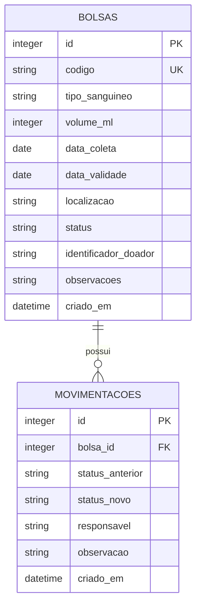

# Banco de dados — HemoFlow

O protótipo usa SQLite. Na primeira execução, `app.py` cria as tabelas, restrições e índices. O arquivo `.db` é local e ignorado pelo Git; não deve ser publicado se contiver dados reais.

## Modelo entidade-relacionamento

## Dicionário de dados

### `bolsas`

| Campo | Tipo | Regra | Descrição |
|---|---|---|---|
| `id` | INTEGER | PK autoincremental | Identificador interno |
| `codigo` | TEXT | Obrigatório, único | Código `HF-` gerado pelo sistema |
| `tipo_sanguineo` | TEXT | Um dos oito tipos válidos | Tipo informado no cadastro |
| `volume_ml` | INTEGER | 1–1000 | Volume ilustrativo em ml |
| `data_coleta` | TEXT | ISO `AAAA-MM-DD` | Data de coleta |
| `data_validade` | TEXT | ISO, ≥ coleta | Data de validade informada |
| `localizacao` | TEXT | Obrigatório | Localização no estoque |
| `status` | TEXT | Enumeração | Situação atual |
| `identificador_doador` | TEXT | Opcional | Somente código interno anonimizado, nunca nome |
| `observacoes` | TEXT | Opcional | Observação operacional curta |
| `criado_em` | TEXT | Padrão UTC SQLite | Momento de criação |

### `movimentacoes`

| Campo | Tipo | Regra | Descrição |
|---|---|---|---|
| `id` | INTEGER | PK autoincremental | Identificador da movimentação |
| `bolsa_id` | INTEGER | FK para `bolsas.id` | Bolsa relacionada |
| `status_anterior` | TEXT | Nulo no cadastro | Situação antes da mudança |
| `status_novo` | TEXT | Obrigatório | Situação resultante |
| `responsavel` | TEXT | Obrigatório | Rótulo local do operador no protótipo |
| `observacao` | TEXT | Opcional | Motivo informado |
| `criado_em` | TEXT | Padrão UTC SQLite | Momento da operação |

## Status e transições

| Status atual | Próximos status permitidos |
|---|---|
| Disponível | Reservada, Transfundida, Descartada, Quarentena |
| Reservada | Disponível, Transfundida, Descartada |
| Quarentena | Disponível, Descartada |
| Transfundida | Nenhum (terminal) |
| Descartada | Nenhum (terminal) |

A API bloqueia transfusão quando a data de validade já passou. A interface destaca vencimentos, mas alterações de status devem sempre obedecer aos protocolos reais — esta lógica é somente didática.

## Integridade e privacidade

As tabelas usam chave estrangeira e restrições `CHECK`; índices cobrem tipo/status, validade e consultas de movimentações. As consultas da aplicação são parametrizadas. O campo de identificador do doador é opcional e deve receber um token anonimizado de demonstração. Não cadastre nomes, documentos, contatos, resultados laboratoriais ou qualquer dado pessoal/saúde real.
